# The classic view

This is how the dashboard first looked: the **FC-1984 control panel**, a rack of
brushed-metal modules with a green-glass Coordinator terminal, a lane module for
every sandbox, a printer that types out every broker call, and, if you pressed
**F**, the **factory floor**: little programs seated at consoles around a track,
with crates riding to a gate. It lived at `/classic`. In November 2026 the
Thoughtfield became the only view and the classic one was retired. These
pictures are here so the look isn't lost.

All shots are of the built-in demo (`factory dashboard --demo`, made-up data),
taken at 1440x900 unless noted, from `main` at commit
`f80f0228f42ad1e4574ceeb99f5606ea03f81abf`. The panel has only one skin, so
there are no separate light and dark versions: it looked the same either way.

## The whole panel

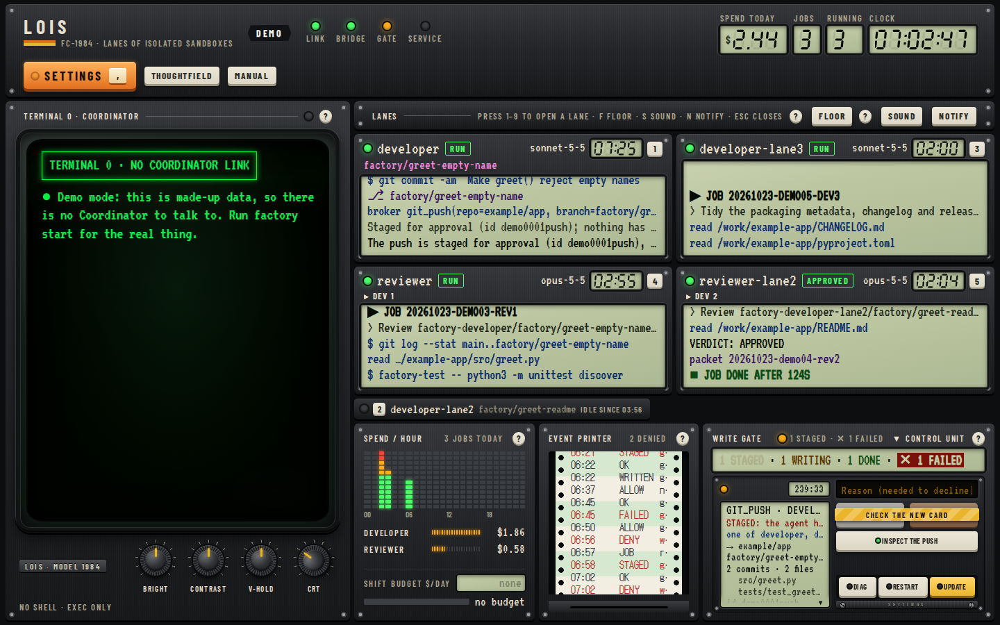
The full control panel: Coordinator terminal on the left, one module per lane, spend, event printer and write gate along the bottom.

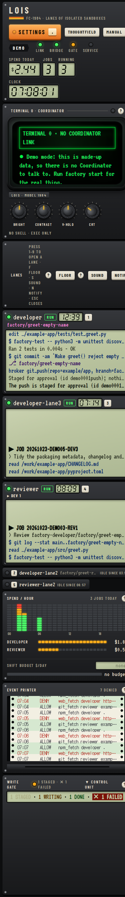
The same page at 390 px wide, one long column.

## The factory floor

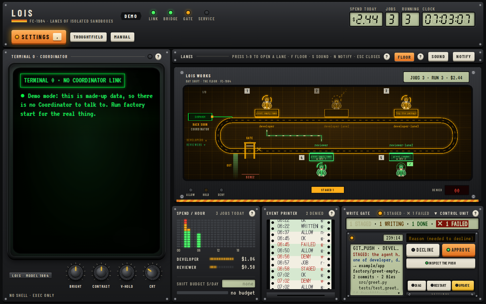
**FLOOR** (or **F**) swaps the lane modules for the floor, with the rail and write gate still in reach.

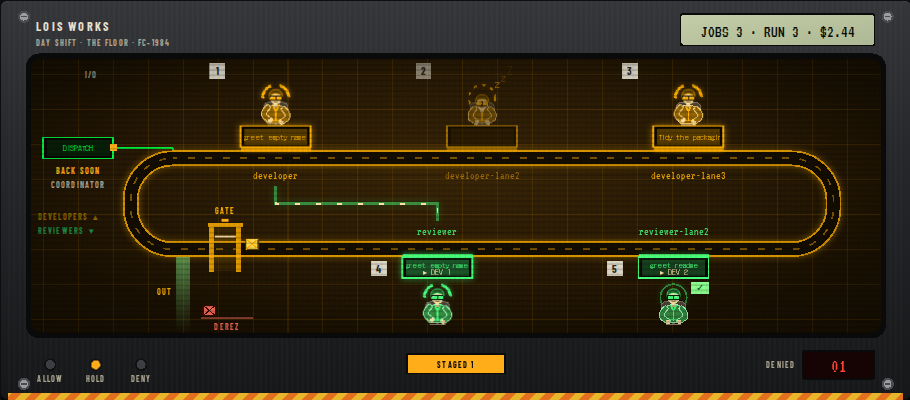
A held write: the yellow crate waits in front of the gate and the HOLD lamp stays on.

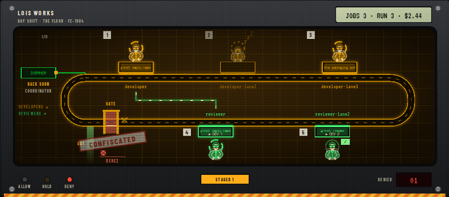
A refused broker call is stamped CONFISCATED, the gate goes red and the DENY LED lights.

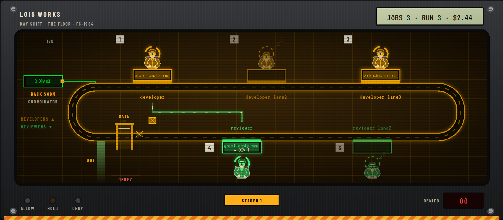
A closer look at the track, stations, dispatch console, light bridge from reviewer to developer, and the gate (shot at twice the resolution).

## The write gate and control unit

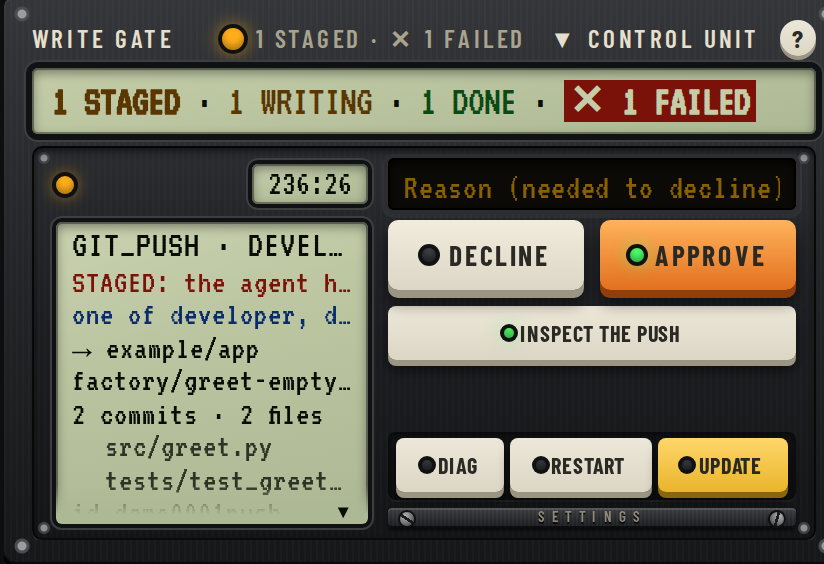
The held `git_push` with its Decline, Approve and Inspect keys, and the DIAG, RESTART and UPDATE service keys.

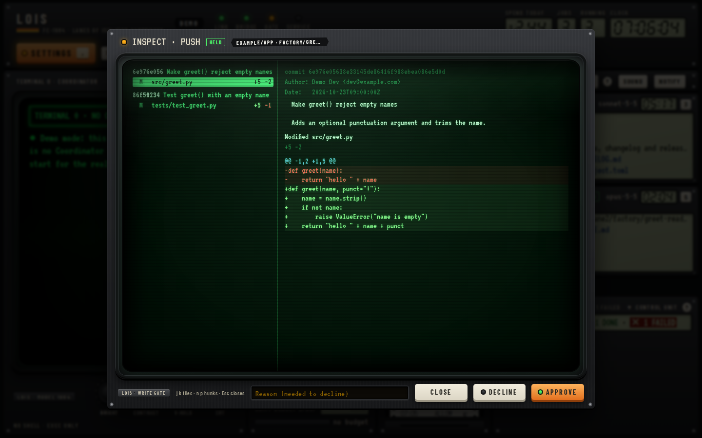
**Inspect the push** opens the patch the broker stored, file by file, before you approve.

## Spend and the event printer

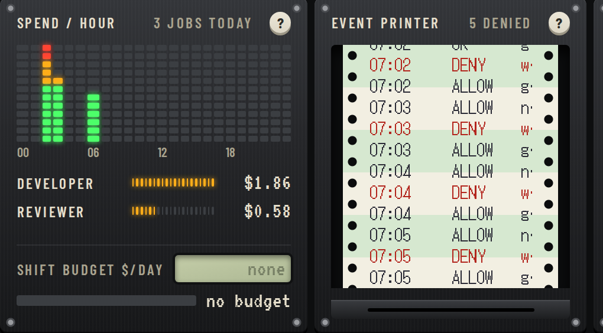
The spend-per-hour bar graph with per-role totals and the shift budget, and the receipt-roll printer with its ALLOW and DENY lines.

## Lane monitors and the briefing

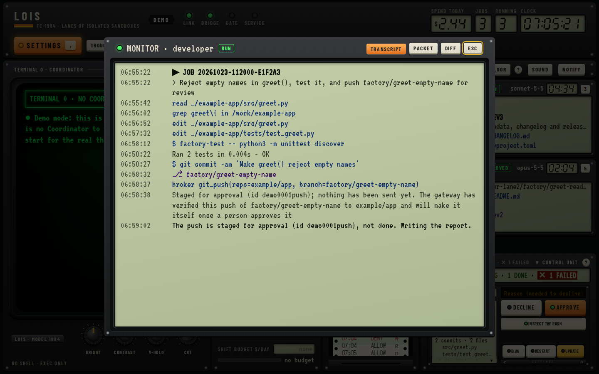
Press a lane's number to open its monitor; the transcript is the default tab.

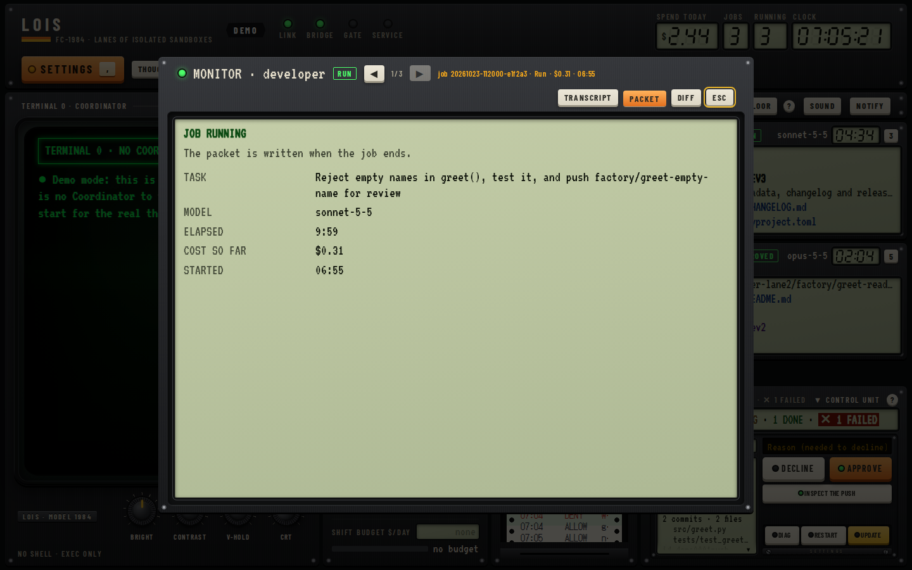
The same monitor on the packet tab (`p`; `d` is the diff).

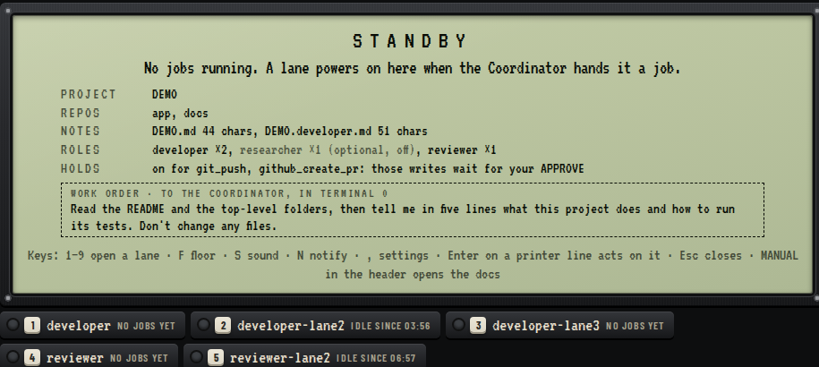
With no jobs running, the lanes give way to the STANDBY briefing: project, repos, notes, roles, holds and a first work order to give the Coordinator. (Shot through a throwaway proxy that marked every demo lane idle, since the demo always has running lanes.)

## Settings

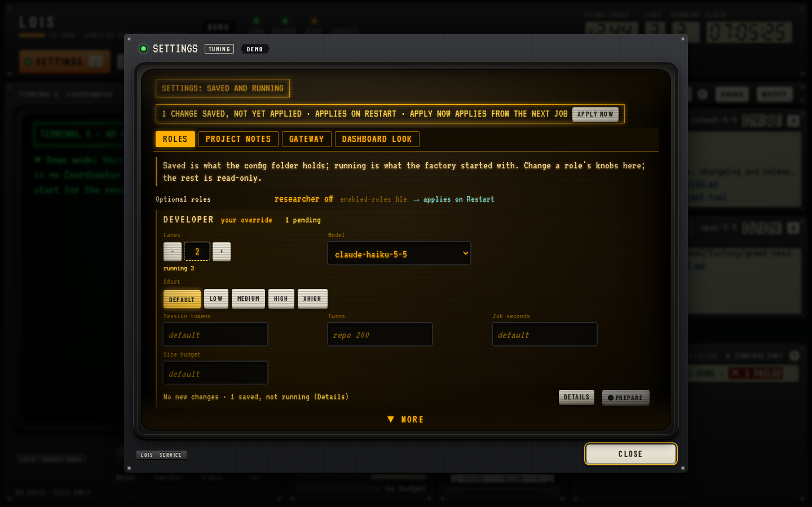
The control unit's **SETTINGS** key opens role knobs: lanes, model, effort and limits.

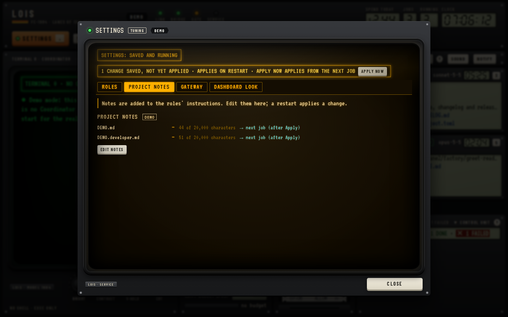
Project notes and how close each is to the size limit.

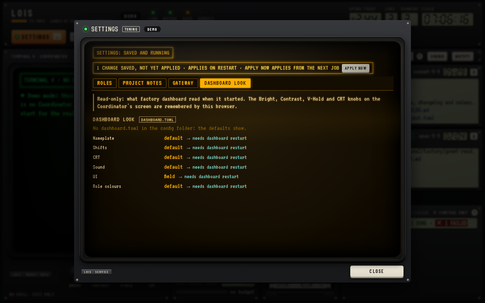
What `dashboard.toml` set, read-only, including which view opens.

## The classic Terminal page

The demo has no Terminal 0, so `term.html` was served from a scratch folder with a
stub WebSocket that sends the page fixed text. The page itself is the real one.

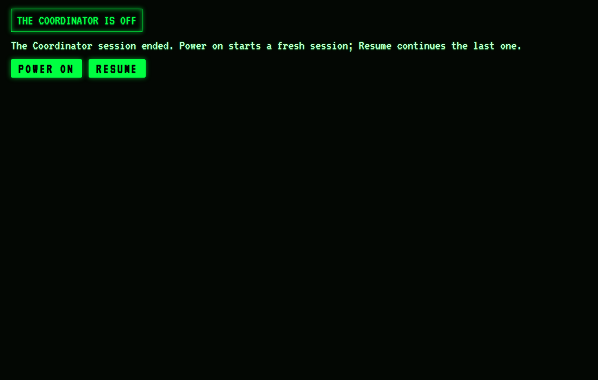
The page's own "The Coordinator is off" state, with POWER ON and RESUME.

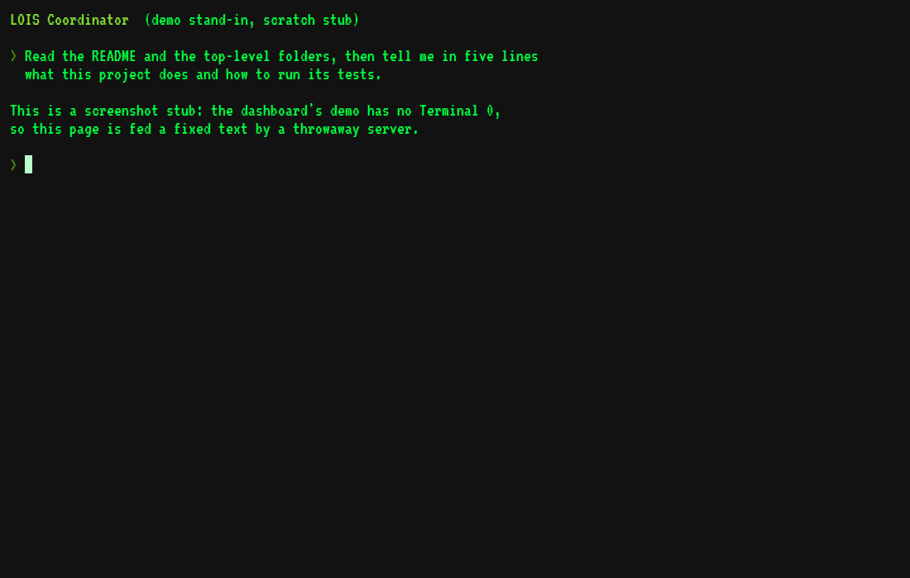
A running session; the text is the stub's, not a real Coordinator's.

## Where it sat next to the Thoughtfield

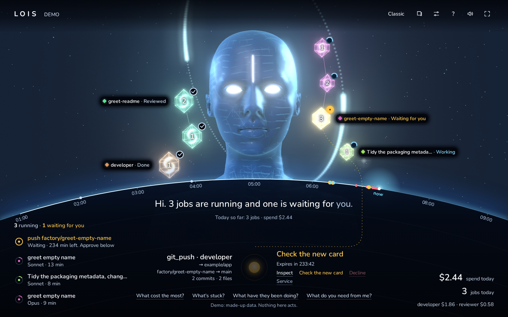
The Thoughtfield's top bar: **Classic** (top right) was the way over to the panel above, and the panel's **Thoughtfield** key was the way back.
